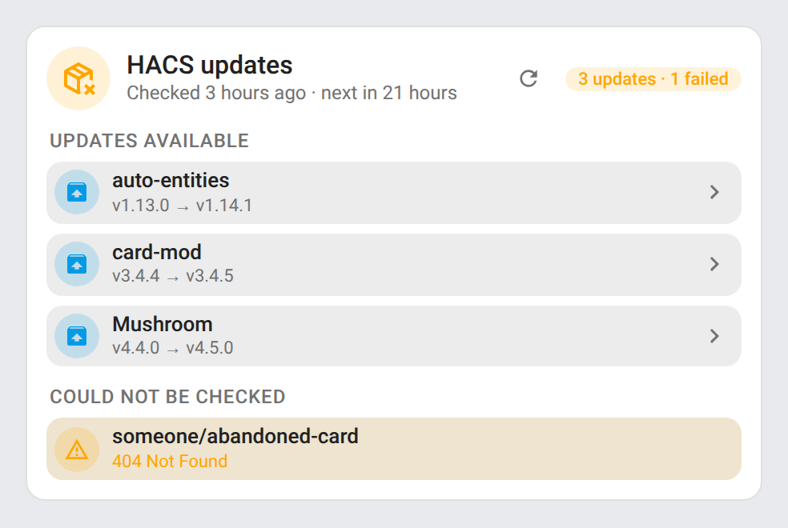
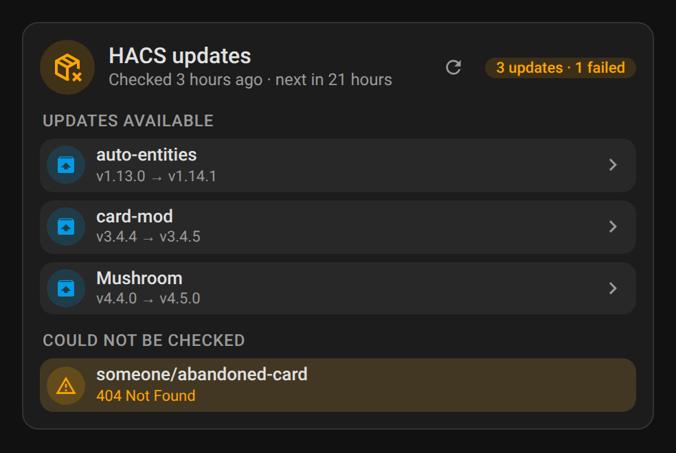
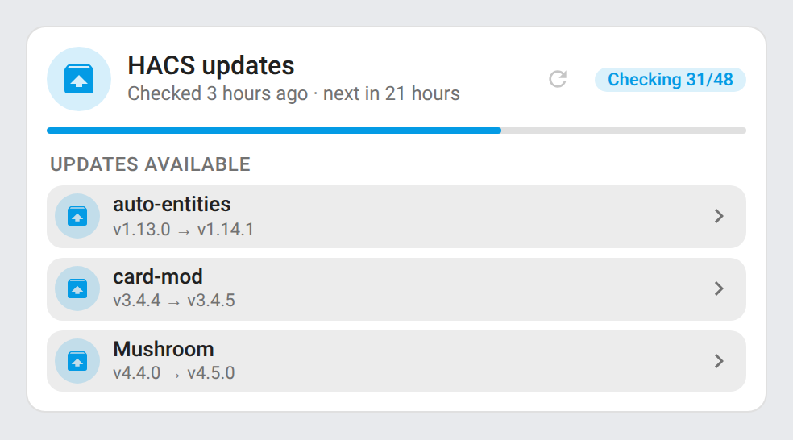
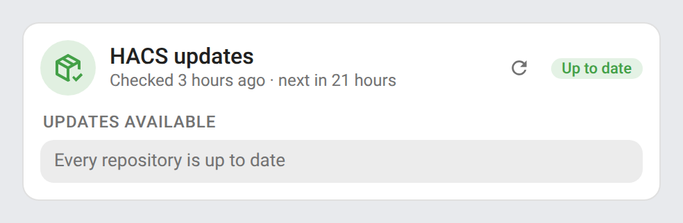
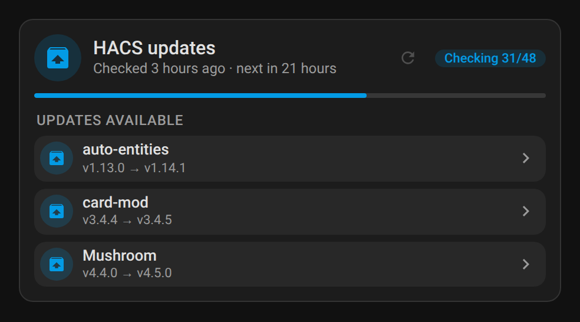
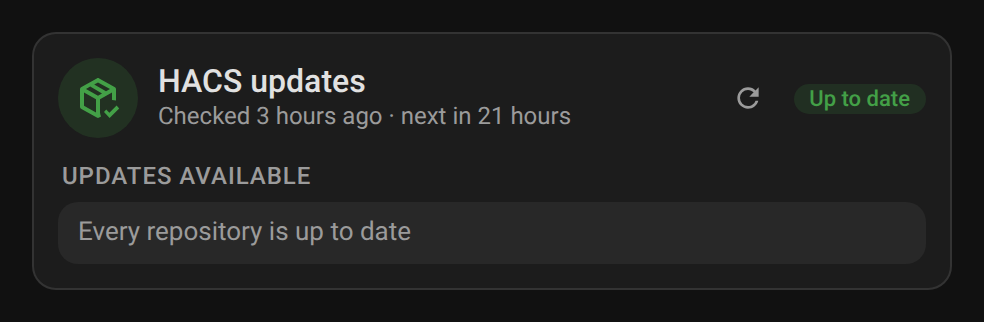

# ha-hacs-refresh

[](https://github.com/hacs/integration)
[](https://github.com/juju35/ha-hacs-refresh/actions/workflows/hacs.yml)
[](https://github.com/juju35/ha-hacs-refresh/actions/workflows/validate.yml)
[](https://github.com/juju35/ha-hacs-refresh/releases/latest)
[](LICENSE)

<p align="center"></p>

Home Assistant integration that checks every repository downloaded with [HACS](https://hacs.xyz) for updates, on the server: with a button, an action, a progress sensor and a check interval set in the integration options.

HACS itself only checks downloaded custom repositories every 48 hours, and its own "update information" button works one repository at a time from the browser. HACS Refresh checks them all at once, in the background, even when no dashboard is open. It comes with a Lovelace card showing the check and the updates available.

<p align="center">
  
  
</p>

[](https://my.home-assistant.io/redirect/hacs_repository/?owner=juju35&repository=ha-hacs-refresh&category=integration)

## Features

- **Check for updates** button and `hacs_refresh.check_updates` action: every repository downloaded with HACS is fetched again from GitHub, four at a time, and HACS' update entities are refreshed
- **`hacs_refresh.check_repository`** action: checks only the repositories behind the HACS update entities you give, and waits for the result
- **Automatic check** at the interval set in the integration options (24 hours by default, `0` to turn it off), counted from the last check and kept across restarts: an overdue check runs as soon as Home Assistant has started
- **Status** sensor (`idle`, `running`, `error`) with the progress (`done` / `total`), the number of updates found and the repositories that failed
- **Last check** sensor (timestamp), with the check interval and when the next automatic check is due
- **Lovelace card** bundled with the integration: status and progress, last and next check, the updates available and the repositories that couldn't be checked
- One failing repository doesn't stop the others; a check never runs twice at the same time, and `check_repository` waits for a full check that is running instead of starting a second one
- Also used by the [System Monitor Card](https://github.com/juju35/ha-system-monitor-card) for its HACS section
- English, French, German and Spanish

## Prerequisites

- Home Assistant 2024.12 or later
- [HACS](https://hacs.xyz) 2.x installed and set up
- The button and both actions are open to every user: they only fetch information, like HACS' own "Update information"; installing updates stays with HACS and its permissions

## Installation

### Via HACS (recommended)

Click the button below to add the repository directly:

[](https://my.home-assistant.io/redirect/hacs_repository/?owner=juju35&repository=ha-hacs-refresh&category=integration)

Then click **Download** and restart Home Assistant.

Or manually:

1. Open HACS → **⋮** (top right) → **Custom repositories**
2. Add `https://github.com/juju35/ha-hacs-refresh` — Type: **Integration**
3. Search for **HACS Refresh** and click **Download**
4. Restart Home Assistant

### Manual

Copy `custom_components/hacs_refresh/` to `/config/custom_components/hacs_refresh/`, then restart Home Assistant.

## Configuration

[](https://my.home-assistant.io/redirect/config_flow_start/?domain=hacs_refresh)

**Settings → Devices & services → Add integration → HACS Refresh**, then choose the check interval. Change it later with the **Configure** button.

| Option | Default | Description |
|---|---|---|
| Check interval | 24 h | Hours between two automatic checks, from 1 to 168. `0` turns the automatic check off. Counted from the end of the last check (or from the installation before the first one), across restarts |

### Entities

| Entity | Description |
|---|---|
| `button.hacs_refresh_check_for_updates` | Starts a check. Unavailable while one is running |
| `sensor.hacs_refresh_status` | `idle`, `running` or `error`. Attributes: `done`, `total`, `updates`, `failed` (list of `owner/repo`), `error`, `checking` (update entities being checked by `check_repository`) |
| `sensor.hacs_refresh_last_check` | End of the last check. Attributes: `scan_interval` (hours, `0` = automatic check off), `next_check` (when the next automatic check is due, `null` when it is off) |

### Action `hacs_refresh.check_updates`

| Field | Default | Description |
|---|---|---|
| `wait` | `false` | Wait until every repository has been checked before the action ends. The action then fails if the check failed or could not check a repository (the error lists them), so the steps after it only run on a complete check |

Check every night and get notified of the updates found:

```yaml
triggers:
  - trigger: time
    at: "04:00:00"
actions:
  - action: hacs_refresh.check_updates
    data:
      wait: true
  - condition: template
    value_template: "{{ state_attr('sensor.hacs_refresh_status', 'updates') | int(0) > 0 }}"
  - action: notify.mobile_app_phone
    data:
      message: "{{ state_attr('sensor.hacs_refresh_status', 'updates') }} HACS update(s) available"
```

### Action `hacs_refresh.check_repository`

| Field | Description |
|---|---|
| `entity_id` | HACS update entities (`update.*` of platform `hacs`) of the repositories to check |

The action ends once the repositories are checked, and fails with the reason if one could not be. It doesn't change the status or the last check, which belong to the full check. While a full check runs, it waits for that check to end and fails if that check failed or could not check one of these repositories; a repository already being checked by another call is not checked twice: the action waits for that call's result, and checks it itself if that call is cancelled first. A full check started meanwhile waits for these repositories too instead of checking them again. If HACS Refresh is reloaded or removed while the action waits (here or with `wait: true`), it fails with "The check was cancelled".

```yaml
action: hacs_refresh.check_repository
data:
  entity_id: update.mushroom_update
```

## Card

The integration serves the **HACS Refresh Card** and adds it to the dashboard resources (or loads it on every page when the resources are managed in YAML): no separate install. Add it from the card picker, or:

```yaml
type: custom:hacs-refresh-card
```

| Updates available | Checking | Up to date |
|---|---|---|
|  |  |  |
|  |  |  |

- **Header**: status (up to date, *n* updates, *n* failed, checking *done/total*, error), when the last check ran and when the next automatic one is due, and the **Check for updates** button
- **Progress bar** while a check runs
- **Updates available**: the HACS repositories with an update, from HACS' own update entities, with the installed and new version. A row opens the update entity, to install it or read the release notes
- **Could not be checked**: the repositories the last check couldn't fetch, and the error of a check that failed

Every option is in the visual editor:

| Option | Default | Description |
|---|---|---|
| `entity` | found automatically | The **Status** sensor |
| `title` | HACS updates | Card title |
| `show_updates` | `true` | Updates available |
| `show_failed` | `true` | Repositories that couldn't be checked, and the error of a failed check |
| `check_button` | `true` | **Check for updates** button in the header |
| `hide_when_ok` | `false` | Hide the card while everything is up to date (it shows while checking, and with an update or an error) |
| `language` | Home Assistant's | `en`, `fr`, `de` or `es` |

The [System Monitor Card](https://github.com/juju35/ha-system-monitor-card) also shows the HACS extensions with their update status, and its **Check for updates** button presses this integration's button.

## How it works

HACS has no action to check everything: its frontend refreshes one repository at a time over its websocket API. HACS Refresh does, for every downloaded repository, what that websocket command does for one: it asks the repository to update its information from GitHub, saves HACS' data, then tells HACS' update entities to refresh. The update entities (`update.*` of platform `hacs`) then show the new latest versions, like after a manual refresh in HACS.

This relies on HACS' internal object (`hass.data["hacs"]`), as HACS' own websocket commands do. The integration checks that the attributes it needs exist: if a future HACS version changes them, the action fails with a clear message instead of breaking Home Assistant.

Checks go through HACS' GitHub client, so they count towards HACS' GitHub API rate limit (5,000 requests per hour with the token HACS asked for at setup).

To debug:

```yaml
logger:
  logs:
    custom_components.hacs_refresh: debug
```

## Development

```bash
pip install -r requirements_test.txt && pytest
node --test test/*.test.mjs        # card
python scripts/screenshots.py      # README screenshots (Playwright)
```

The tests use a stand-in for HACS' internal object (`tests/conftest.py`).

### Releasing

1. Bump the version in `custom_components/hacs_refresh/manifest.json`, `const.py` (`VERSION`) and the card (`HACS_REFRESH_CARD_VERSION`)
2. Add a `## <version>` section at the top of [CHANGELOG.md](CHANGELOG.md)
3. Push to `main`: once **Validate**, **Lint** and **HACS Validation** have passed on that commit, the **Release** workflow creates the tag and the GitHub release with the changelog section as notes

## Translations

The integration follows the language of Home Assistant. Currently supported:

| Language | Code |
|---|---|
| English | `en` |
| Français | `fr` |
| Deutsch | `de` |
| Español | `es` |

Contributions for additional languages are welcome!

## License

[MIT](LICENSE)

Not affiliated with HACS.
